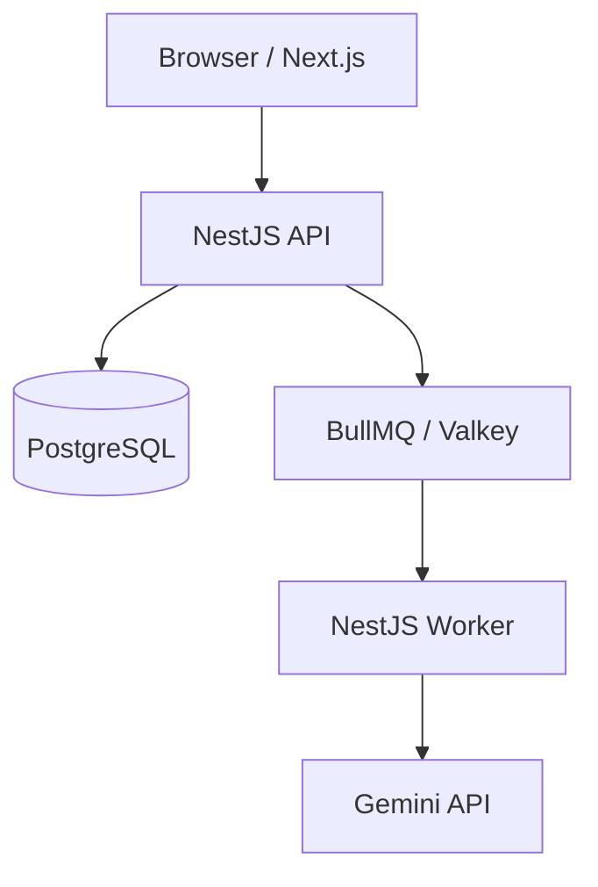

# LearnMap MVP — Phases 1–16

LearnMap turns a public YouTube lesson into a bilingual structured summary and an
interactive, timestamped mind map. This repository contains the complete Phase 1 product,
the Phase 2 development environment, the Phase 3 production-grade monorepo foundation,
the Phase 4 local PostgreSQL and Valkey infrastructure, the Phase 5 shared data contract, and
the Phase 6 relational database design and migration workflow, the Phase 7 secure YouTube URL
and metadata ingestion boundary, the Phase 8 authenticated, rate-limited API, the Phase 9
production-oriented BullMQ worker lifecycle, the Phase 10 replaceable AI-provider boundary, and
the Phase 11 complete bilingual learning interface, the Phase 12 production-grade Arabic,
English, and mixed-direction language model, and Phase 13 managed OIDC authentication,
authorization, and distributed usage controls, plus Phase 14 production security, privacy,
auditing, retention, and deletion controls, and Phase 15's deterministic unit, HTTP integration,
worker-recovery, browser end-to-end, and versioned AI-quality evaluation suites, plus Phase 16's
privacy-safe logging, metrics, error reporting, worker heartbeats, uptime probes, and alerts.

## Implemented features

- Public `youtube.com`, `youtu.be`, Shorts, embed, and live URL parsing
- YouTube metadata, privacy, embeddability, and 90-minute duration validation
- Arabic or English analysis output
- Asynchronous Gemini video analysis using BullMQ
- Validated structured summaries and bounded hierarchical mind maps
- Interactive React Flow map with automatic ELK layout
- Timestamp navigation in a privacy-enhanced YouTube player
- Durable per-browser analysis history in PostgreSQL
- Deduplication, caching, progress polling, safe retries, and daily limits
- Responsive bilingual interface with RTL support
- Swagger API documentation, migrations, unit tests, and operational health checks
- Pinned Node.js and pnpm runtimes with strict engine enforcement
- Cross-platform automated setup, environment checks, and service diagnostics
- Reproducible VS Code Dev Container and shared editor configuration
- Runtime-validated API, worker, and web environment contracts
- Shared ESLint and strict TypeScript configuration packages
- Workspace structure validation and dependency-boundary conventions
- Tailwind CSS and `next-intl` foundations for the bilingual web application
- Health-gated PostgreSQL 17 and persistent Valkey 8 local services
- Safe infrastructure lifecycle commands and automated Compose validation
- One strict Zod result contract shared by the web, API, worker, and Gemini integration
- Complete map-graph, timestamp, and malformed-provider-output validation
- Relational user ownership with cascading analysis cleanup and preserved anonymous history
- Forward-only Prisma migrations and database-level numeric integrity constraints
- SSRF-resistant YouTube URL parsing with independently validated canonical URLs
- Typed YouTube metadata responses, fixed-origin requests, timeouts, and safe upstream errors
- OIDC bearer-token verification against a configured JWKS endpoint
- Browser Authorization Code + PKCE sign-in using provider discovery and session-scoped tokens
- Development-only anonymous compatibility mode that is forbidden in production
- User-scoped repository queries for create, history, detail, status, retry, and deletion
- Redis-backed normal, moderate, and strict per-user request throttling
- Atomic PostgreSQL daily-usage ledger with concurrency-safe quota enforcement
- Global request IDs, structured JSON request logs, and stable safe error envelopes
- Queue failure compensation and atomic failed-to-queued retry transitions
- Shared, strict queue payloads and deterministic queue-level deduplication IDs
- Separate worker process with configurable concurrency and graceful shutdown
- Real worker-backed learning phases at 10%, 25%, 70%, 85%, 95%, and 100%
- Worker-side YouTube metadata revalidation before each AI attempt
- Explicit permanent/transient error classification and final-attempt failure persistence
- Sanitized worker errors that never store raw provider or infrastructure diagnostics
- Runtime-injectable `VideoAnalysisProvider` with a Gemini implementation
- Prompt-injection-resistant English and Arabic educational analysis instructions
- JSON Schema structured output with static/agentic video-mode selection
- Timestamp cleanup, Unicode/whitespace normalization, and final defensive validation
- Locale-prefixed English and Arabic routes with document-level LTR and RTL direction
- Shared-contract form validation, recent history, complete history, and persistent preferences
- Structured five-section result view and accessible processing timeline
- Searchable, collapsible, keyboard-operable ELK mind map with locale-aware direction
- YouTube IFrame API seeking with privacy-enhanced embedding and a timestamped fallback link
- Independent interface, detected-video, and analysis-output language fields
- Typed `next-intl` translations with English/Arabic key and placeholder parity tests
- Persisted detected video language with a forward-only Prisma migration
- Bidirectional isolation for mixed Arabic and technical English content
- Logical CSS spacing, Arabic-capable typography, stable LTR timestamps, and non-mirrored media
- Per-request nonce Content Security Policy and restrictive browser permissions policy
- Bounded JSON request bodies, no-store API responses, and hardened public error sanitization
- Pseudonymous audit events for analysis, account, retention, and secret-rotation operations
- Automated, single-runner retention sweeps for completed/failed analyses and audit history
- Authenticated analysis deletion and explicitly confirmed application-account deletion
- Learner notices that generated material may be incomplete and does not replace the video
- Isolated Vitest unit suites and Supertest HTTP integration coverage with no live Google calls
- Mocked-provider worker recovery, retry, duplicate-job, and invalid-output tests
- Playwright coverage for OIDC sign-in, polling, summary, mind map, timestamp seek, and RTL
- A locked 20-video Arabic/English quality dataset with scored prompt-release gates
- Allowlisted correlated JSON logs with request-to-worker traceability and secret redaction
- Prometheus metrics for throughput, completion, latency, errors, queue health, cost, and caching
- Sentry integration for Next.js, API, and worker with PII-disabled event scrubbing
- Worker heartbeat readiness, optional local monitoring, and actionable alert runbooks

## Architecture



The API responds immediately with `202 Accepted`. The worker performs the long-running
analysis and saves the validated result. The browser polls the analysis record until it is
ready. See [docs/ARCHITECTURE.md](docs/ARCHITECTURE.md) for design decisions.

## Fastest setup

Install Git and Docker Desktop, then use the pinned Node.js 24 runtime. From the project
root run:

```bash
pnpm setup
```

On Windows PowerShell, the direct setup entrypoint is:

```powershell
./scripts/setup.ps1
```

On macOS, Linux, or WSL:

```bash
./scripts/setup.sh
```

The setup tool installs exact dependencies, creates `.env` when needed, starts PostgreSQL
and Valkey, waits for them to become reachable, and applies the committed migration. It
never generates or prints credentials. Add the required Google keys to `.env`, then run:

```bash
pnpm env:check
pnpm doctor:services
pnpm dev
```

For detailed operating-system instructions, see
[Development environment](docs/DEVELOPMENT_ENVIRONMENT.md).

For a complete first-run walkthrough from extracting the archive through testing and shutdown,
see [How to run LearnMap](docs/HOW_TO_RUN.md).

## Requirements

- Node.js 24, pinned by `.nvmrc` and `.node-version`
- pnpm 11.19.0 through Corepack
- Docker Desktop or Docker Engine with Compose
- A Gemini API key
- A Google Cloud project with YouTube Data API v3 enabled and an API key

## API keys

### Gemini

1. Open Google AI Studio.
2. Create an API key.
3. Put it in `GEMINI_API_KEY` in `.env`.

The application uses Gemini's public YouTube URL input. That capability is currently a
preview feature and its model availability, limits, and pricing can change. The integration
is isolated in `apps/worker/src/gemini-video-analysis.provider.ts` for this reason.

### YouTube Data API

1. Create or select a Google Cloud project.
2. Enable **YouTube Data API v3**.
3. Create an API key.
4. Restrict that key to YouTube Data API v3.
5. Put it in `YOUTUBE_API_KEY` in `.env`.

## Manual local setup

From the repository root:

```bash
corepack enable
corepack install --global pnpm@11.19.0
pnpm install
cp .env.example .env
```

Fill in the two required keys in `.env`, then start PostgreSQL and Valkey:

```bash
pnpm infra:up
```

Apply the included database migration:

```bash
pnpm --filter @learnmap/database db:deploy
```

Start every application:

```bash
pnpm dev
```

Open:

- English web interface: `http://localhost:3000/en`
- Arabic web interface: `http://localhost:3000/ar`
- API: `http://localhost:4000/v1`
- Swagger documentation: `http://localhost:4000/docs`
- Health check: `http://localhost:4000/health`

## Development commands

```bash
pnpm dev          # Run web, API, worker, and package watchers
pnpm setup        # Cross-platform dependency, infrastructure, and migration setup
pnpm doctor       # Check tools and configuration
pnpm doctor:services # Also check PostgreSQL and Valkey reachability
pnpm env:check    # Check required values without printing secrets
pnpm db:validate  # Validate the Prisma data model without connecting to PostgreSQL
pnpm workspace:check # Validate monorepo structure and internal dependencies
pnpm infra:check  # Validate infrastructure files without Docker
pnpm infra:config # Validate the Compose model with Docker
pnpm infra:up     # Start PostgreSQL and Valkey and wait for health
pnpm infra:observability # Start local Prometheus, Alertmanager, and health probing
pnpm infra:status # Show container state and health
pnpm infra:logs   # Show the latest local infrastructure logs
pnpm build        # Production build for all workspaces
pnpm test         # Run automated tests
pnpm test:integration # Run the NestJS HTTP integration suite
pnpm test:e2e:install # Install the pinned Chromium test browser once
pnpm test:e2e     # Run the fully mocked browser journey
pnpm eval:ai dataset # Validate and describe the locked AI evaluation set
pnpm typecheck    # Strict TypeScript checks
pnpm lint         # Lint applications and packages
pnpm format       # Format source files
pnpm format:check # Verify formatting without changing files
pnpm validate     # Run the complete local quality gate
pnpm infra:down   # Stop local infrastructure
pnpm db:studio    # Open Prisma Studio
```

See [Phase 16 observability](docs/OBSERVABILITY.md) for dashboards, Sentry, uptime monitoring,
alert thresholds, runbooks, privacy controls, and production rollout guidance.

## First test

1. Start all services.
2. Open the web interface.
3. Paste a public, embeddable YouTube lesson shorter than 90 minutes.
4. Select Arabic or English.
5. Submit it.
6. Keep the result page open while the worker processes the video.
7. Select map nodes to read explanations and open timestamps.

## Authentication and user records

For local development, the browser generates a random identifier and sends it as `X-Client-Id`.
This compatibility mode works only when `ALLOW_ANONYMOUS_AUTH=true` and `NODE_ENV` is not
`production`. It is convenient for running the project without an identity tenant, but it is
not proof of identity.

Production uses `Authorization: Bearer <JWT>`. The API verifies the token signature against the
configured JWKS endpoint and validates issuer, audience, expiry, not-before, and subject claims.
Production environment validation refuses to start while anonymous mode is enabled. The stable,
issuer-scoped subject hash becomes the internal user ID.

The browser implements provider-neutral OIDC discovery and Authorization Code with PKCE `S256`.
Tokens are stored only for the browser tab session and attached as bearer credentials; the API
remains the cryptographic authority. Configure a managed provider with the exact callback URL and
matching API audience. See [Phase 13 authentication and usage](docs/AUTHENTICATION_AND_USAGE.md).

## Environment variables

| Variable                              | Required | Purpose                                           |
| ------------------------------------- | -------: | ------------------------------------------------- |
| `DATABASE_URL`                        |      Yes | PostgreSQL connection string                      |
| `REDIS_URL`                           |      Yes | BullMQ-compatible Valkey/Redis connection         |
| `GEMINI_API_KEY`                      |      Yes | Server-side Gemini credential                     |
| `GEMINI_VIDEO_MODEL`                  |      Yes | Configurable compatible model name                |
| `GEMINI_AGENTIC_MIN_DURATION_SECONDS` |       No | Agentic threshold; defaults to `300`              |
| `GEMINI_REQUEST_TIMEOUT_MS`           |       No | Provider timeout; defaults to `720000`            |
| `YOUTUBE_API_KEY`                     |      Yes | Server-side YouTube metadata credential           |
| `WEB_URL`                             |      Yes | Exact allowed browser origin                      |
| `API_URL`                             |      Yes | Canonical API origin                              |
| `NEXT_PUBLIC_API_URL`                 |      Yes | Public API base URL used by Next.js               |
| `ALLOW_ANONYMOUS_AUTH`                |       No | Local-only compatibility mode; forbidden in prod  |
| `JWT_ISSUER`                          |  In prod | Exact trusted OIDC issuer                         |
| `JWT_AUDIENCE`                        |  In prod | Required API audience                             |
| `JWT_JWKS_URL`                        |  In prod | HTTPS signing-key endpoint                        |
| `NEXT_PUBLIC_OIDC_ISSUER`             |  In prod | Browser identity-provider issuer                  |
| `NEXT_PUBLIC_OIDC_CLIENT_ID`          |  In prod | Public browser client ID                          |
| `NEXT_PUBLIC_OIDC_AUDIENCE`           |  In prod | API audience requested by the browser             |
| `NEXT_PUBLIC_OIDC_REDIRECT_URI`       |  In prod | Exact registered PKCE callback URL                |
| `RATE_LIMIT_TTL_MS`                   |       No | Global rate-limit window; defaults to `60000`     |
| `RATE_LIMIT_MAX`                      |       No | Global requests per window; defaults to `60`      |
| `RATE_LIMIT_CREATE_TTL_MS`            |       No | Create/retry window; defaults to `60000`          |
| `RATE_LIMIT_CREATE_MAX`               |       No | Create/retry requests; defaults to `5`            |
| `RATE_LIMIT_STATUS_TTL_MS`            |       No | Status-poll window; defaults to `60000`           |
| `RATE_LIMIT_STATUS_MAX`               |       No | Status requests; defaults to `30`                 |
| `REQUEST_BODY_LIMIT_BYTES`            |       No | JSON body limit; defaults to `16384`              |
| `MAX_VIDEO_DURATION_SECONDS`          |       No | Defaults to `5400`                                |
| `DAILY_ANALYSIS_LIMIT`                |       No | Defaults to `5`                                   |
| `ANALYSIS_RETENTION_DAYS`             |       No | Terminal-analysis retention; defaults to `90`     |
| `AUDIT_RETENTION_DAYS`                |       No | Audit-event retention; defaults to `365`          |
| `RETENTION_SWEEP_INTERVAL_MS`         |       No | Retention interval; defaults to one day           |
| `AUDIT_HASH_PEPPER`                   |  In prod | Secret HMAC pepper for audit pseudonyms           |
| `GEMINI_KEY_VERSION`                  |  In prod | Non-secret Gemini rotation deployment label       |
| `YOUTUBE_KEY_VERSION`                 |  In prod | Non-secret YouTube rotation deployment label      |
| `WORKER_CONCURRENCY`                  |       No | Defaults to `2`                                   |
| `ANALYSIS_PROMPT_VERSION`             |       No | Invalidates cached results after prompt changes   |
| `ANALYSIS_SCHEMA_VERSION`             |       No | Invalidates cached results after contract changes |

## Data and errors

- AI output is parsed and validated with Zod before persistence.
- Maps must have exactly one root, known parents, no cycles, maximum depth four, maximum
  six children per node, and no more than 30 nodes.
- Provider timestamps outside the known video duration are changed to `null`; the final stored
  contract still rejects any out-of-range timestamp that reaches persistence.
- Provider details are recorded, but credentials and raw authorization headers are not.
- End users receive safe errors; provider errors remain on the worker side.

## Documentation

- [Architecture](docs/ARCHITECTURE.md)
- [API contract](docs/API.md)
- [Shared analysis data contract](docs/DATA_CONTRACT.md)
- [Database design and migrations](docs/DATABASE.md)
- [YouTube URL and metadata integration](docs/YOUTUBE_INTEGRATION.md)
- [Phase 8 API implementation](docs/API_IMPLEMENTATION.md)
- [Phase 9 BullMQ worker](docs/BULLMQ_WORKER.md)
- [Phase 10 AI provider](docs/AI_PROVIDER.md)
- [Phase 11 frontend](docs/FRONTEND.md)
- [Phase 12 internationalization](docs/INTERNATIONALIZATION.md)
- [Phase 13 authentication and usage](docs/AUTHENTICATION_AND_USAGE.md)
- [Phase 14 security and privacy](docs/SECURITY_AND_PRIVACY.md)
- [Security](docs/SECURITY.md)
- [Testing and quality](docs/TESTING.md)
- [Deployment guide](docs/DEPLOYMENT.md)
- [Troubleshooting](docs/TROUBLESHOOTING.md)
- [Development environment](docs/DEVELOPMENT_ENVIRONMENT.md)
- [Google credentials](docs/GOOGLE_CREDENTIALS.md)
- [Contributing](CONTRIBUTING.md)
- [Monorepo architecture](docs/MONOREPO.md)
- [Local infrastructure](docs/LOCAL_INFRASTRUCTURE.md)

## Important limitations

- Only public, embeddable YouTube videos are supported.
- Gemini's direct YouTube URL feature is in preview.
- AI-generated explanations and timestamps can be imperfect.
- Generated summaries may be incomplete and must not replace the original educational material.
- Anonymous browser identity is intentionally limited to non-production environments.
- In anonymous development mode only, clearing local storage creates a new empty identity.
- The application does not scrape captions or download video files.

## License

Private application starter. Add the license appropriate for your organization before
public distribution.
