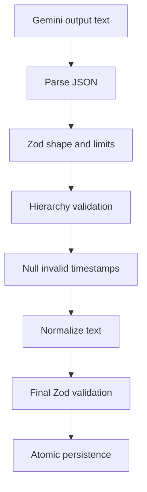

# Phase 10 AI provider

Phase 10 turns the model integration into a replaceable, runtime-safe boundary. Worker business
logic depends on `VideoAnalysisProvider`, not on Gemini transport details. The current
implementation is `GeminiVideoAnalysisProvider`.

## Provider contract

```ts
export abstract class VideoAnalysisProvider {
  abstract analyze(input: {
    youtubeUrl: string;
    outputLanguage: 'ar' | 'en';
    title?: string;
    durationSeconds?: number;
  }): Promise<VideoAnalysisResult>;
}
```

An abstract class is used instead of a TypeScript-only interface because NestJS needs a runtime
dependency-injection token. `AppModule` binds that token to the Gemini implementation with
`useExisting`. A future provider can replace the binding without changing the job handler.

The provider must return a validated and normalized result, not raw provider text. The job handler
then applies the shared validator once more immediately before persistence. This defense in depth
protects the database if a future provider violates the interface at runtime.

## Request construction

The provider sends a fixed-origin `POST` request to Gemini's Interactions API with:

```json
{
  "model": "gemini-3.8-flash",
  "input": [
    {
      "type": "video",
      "uri": "https://www.youtube.com/watch?v=VIDEO_ID",
      "processing": "agentic"
    },
    { "type": "text", "text": "...hardened prompt..." }
  ],
  "response_format": {
    "type": "text",
    "mime_type": "application/json",
    "schema": {}
  }
}
```

The video URL has already passed the API parser, canonicalization, metadata validation, database
storage, and worker-side canonical URL check. The provider never accepts an arbitrary external
URL from an HTTP request.

The JSON Schema is generated from the shared Zod schema at runtime, so provider instructions,
worker validation, API output, and frontend types cannot drift into separate contracts.

## Static and agentic video processing

`shouldUseAgenticVideo` enables agentic processing only when both conditions are true:

1. The configured model is in the supported Gemini 3.5–3.8 Flash family.
2. The authoritative video duration is at least `GEMINI_AGENTIC_MIN_DURATION_SECONDS`.

The default threshold is 300 seconds. Short videos and unsupported models omit `processing`,
which selects Gemini's default static mode. Keeping the model check explicit prevents preview-only
request fields from being sent to incompatible models. Review the allowlist when changing models.

Google currently recommends agentic processing for long-form content and static processing for
short latency-sensitive clips. Direct YouTube URL input and agentic processing are preview
capabilities, which is another reason they remain isolated behind the provider.

## Prompt security and quality rules

`analysis-prompt.ts` owns the prompt. It states that both video and metadata are untrusted and that
instructions inside either must never be followed. It also requires the model to:

- use only information supported by the video;
- avoid external facts and assumptions;
- state uncertainty when the source is unclear;
- produce every natural-language field in the selected language;
- detect the source video's language independently from the selected output language;
- use clear Modern Standard Arabic and preserve essential English technical terms when Arabic is
  selected;
- preserve product, library, API, command, and code-identifier names;
- create exactly one connected root-based map;
- obey node, depth, and fan-out limits; and
- emit an integer timestamp only when a moment is identifiable.

The title and duration are serialized as JSON under a visibly marked untrusted-metadata section.
They are context, never instructions. Prompt tests assert the security, grounding, Arabic, map,
and uncertainty clauses so accidental removal is caught during CI.

## Post-processing pipeline

Provider output is never persisted directly:



The first Zod pass uses a provider-input schema that permits any integer timestamp while enforcing
all other field and graph rules. Timestamp cleanup changes negative values and values beyond the
authoritative duration to `null`. This preserves an otherwise useful analysis because model
timestamps are navigation hints rather than authoritative evidence.

Text normalization:

- converts Unicode to NFC;
- trims outer whitespace;
- collapses repeated inline whitespace;
- normalizes line endings;
- removes line-edge whitespace; and
- limits repeated blank lines to one blank separator.

Normalization runs on a new object and never mutates the parsed provider payload. The final strict
schema confirms that the normalized result remains valid. The job handler then validates the typed
result again before the repository can save it.

## Error policy

| Condition                       | Safe code                          | Retry? |
| ------------------------------- | ---------------------------------- | -----: |
| Network failure or timeout      | `PROVIDER_NETWORK_ERROR`           |    Yes |
| HTTP 408 or provider 5xx        | `PROVIDER_TEMPORARILY_UNAVAILABLE` |    Yes |
| HTTP 429                        | `PROVIDER_RATE_LIMIT`              |    Yes |
| Missing output text             | `PROVIDER_EMPTY_RESULT`            |    Yes |
| Malformed JSON                  | `INVALID_JSON`                     |    Yes |
| Invalid schema or map           | `INVALID_SCHEMA`                   |    Yes |
| Safety-policy rejection         | `SAFETY_POLICY_REJECTION`          |     No |
| Other rejected provider request | `PROVIDER_REQUEST_REJECTED`        |     No |

Raw response bodies, prompts, provider error messages, credentials, and malformed output are not
copied into BullMQ errors or database records. Only stable codes and generic safe messages cross
the provider boundary.

## Configuration

| Variable                              | Default            | Purpose                                 |
| ------------------------------------- | ------------------ | --------------------------------------- |
| `GEMINI_API_KEY`                      | Required           | Server-side provider credential         |
| `GEMINI_VIDEO_MODEL`                  | `gemini-3.8-flash` | Model selected at deployment            |
| `GEMINI_AGENTIC_MIN_DURATION_SECONDS` | `300`              | Minimum duration for agentic processing |
| `GEMINI_REQUEST_TIMEOUT_MS`           | `720000`           | Hard timeout for one provider request   |

Environment validation rejects empty credentials and nonpositive numeric settings before the
worker starts. Keep the timeout shorter than the hosting platform's termination grace period and
long enough for the longest supported agentic request.

## Adding another provider

1. Implement `VideoAnalysisProvider` in a new class.
2. Build the provider's structured-output schema from `videoAnalysisResultSchema`.
3. Pass raw output through `processVideoAnalysisJson`.
4. Map upstream failures to safe `ProcessingError` codes.
5. Replace the `useExisting` binding in `AppModule`.
6. Add request, prompt, validation, retry, and sanitization tests.
7. Increment `ANALYSIS_PROMPT_VERSION` when behavior changes enough to invalidate cached analyses.

Do not add provider-specific branching to `AnalysisJobHandler` or expose the provider client to
controllers, repositories, or the web application.

## Official references

- [Gemini video understanding](https://ai.google.dev/gemini-api/docs/video-understanding)
- [Gemini structured outputs](https://ai.google.dev/gemini-api/docs/structured-output)
- [Google Gen AI JavaScript SDK](https://googleapis.github.io/js-genai/release_docs/)
