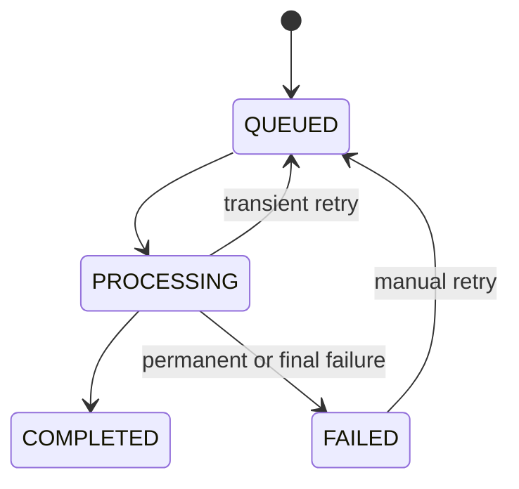
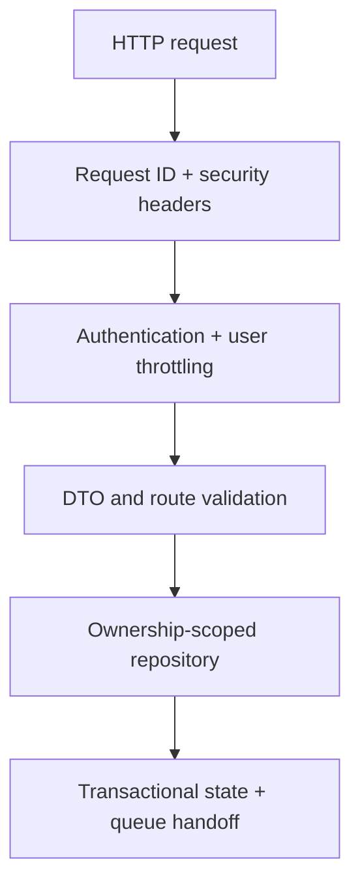

# Architecture

## System responsibilities

### Web application

The Next.js application owns presentation and device-local preferences only. It sends an OIDC
access token obtained through Authorization Code with PKCE when one is configured and otherwise uses the local-only anonymous compatibility
identity. It submits analysis requests, polls status, renders structured results, lays out
mind-map nodes, and controls timestamp navigation. Every route has an explicit English or Arabic
locale prefix. ELK derives coordinates from validated parent relationships, while React Flow owns
map interaction; neither the model nor the database stores presentation coordinates. See
[Phase 11 frontend](FRONTEND.md).

### API

The NestJS API is the synchronous trust boundary. It authenticates OIDC JWTs, validates headers
and DTOs, applies shared Redis per-user throttling and an atomic PostgreSQL daily allowance, reduces an
untrusted YouTube URL to a format-restricted video ID, retrieves authoritative metadata from one
fixed Google endpoint, creates the anonymous user ownership record, enforces limits, deduplicates
requests, persists the server-built canonical URL, and enqueues work. It never performs long AI
work inside an HTTP request.

### Worker

The worker consumes BullMQ jobs and is the only application that knows the AI-provider interface.
It updates observable progress, revalidates the video, invokes the configured provider, performs
a final defensive result check, and commits the analysis atomically.
Its persisted and emitted progress values are the source of truth for the learner-facing phase
labels; the client does not manufacture elapsed progress.

### Shared packages

`@learnmap/contracts` is the source of truth for runtime schemas and inferred compile-time types.
The injected AI provider owns provider transport, prompt construction, structured-output parsing,
graph validation, timestamp cleanup, and text normalization. The worker reapplies the final shared
contract immediately before persistence.
`@learnmap/database` owns the Prisma schema, forward migrations, integrity constraints, and the
shared process-local database client.

`DailyUsage` is the source of truth for UTC-day analysis creation quotas. Redis counters protect
short request windows across API replicas; PostgreSQL transactions protect durable entitlement.

Language has three owners: the locale route owns interface language, the provider result owns
detected video language, and the create request owns analysis output language. The worker persists
the detected language only after validation. See [Phase 12 internationalization](INTERNATIONALIZATION.md).

## Analysis lifecycle



The processor is idempotent: missing jobs and already completed analyses are safe no-ops.
Database state remains authoritative; Redis is a delivery mechanism, not the system of record.
The worker revalidates YouTube availability, validates provider output after the provider returns,
and persists only safe errors. See [Phase 9 BullMQ worker](BULLMQ_WORKER.md).

## Caching and deduplication

The cache key is a SHA-256 digest of:

```text
video ID + output language + prompt version + schema version
```

It is unique per user. Changing a prompt or output contract creates a fresh result
instead of silently reusing incompatible data.

## Provider isolation

`VideoAnalysisProvider` defines the internal interface. The Gemini implementation can be
replaced by another compliant provider without changing queue processing, API contracts,
database design, or UI code.

## Trust boundaries

- A submitted URL is untrusted and is reduced to an 11-character YouTube video ID.
- User-provided hosts and paths are never fetched; metadata uses a fixed Google API endpoint.
- A canonical YouTube URL is independently validated and reconstructed server-side.
- Video content is untrusted and explicitly prohibited from instructing the AI.
- AI output is untrusted until it passes JSON, schema, graph, and timestamp validation.
- Client IDs currently become anonymous user IDs; they are partition keys, not authentication
  credentials. In development only, the anonymous client identifier is accepted behind an explicit
  environment flag.

## Scalability

The API and worker are stateless apart from external PostgreSQL and Valkey services. Multiple
API replicas can enqueue jobs and multiple workers can consume them. Increase worker
concurrency carefully because the upstream AI provider is usually the binding rate and cost
limit.

## API request lifecycle



Controllers do not access Prisma. `AnalysesRepository` is the only API component that performs
analysis persistence and every read, update, and delete includes the authenticated user ID.

## Security and privacy lifecycle

The web middleware creates a fresh CSP nonce per document request. The API bounds parsing before
DTO validation, authenticates the caller, applies distributed throttling, and returns non-cacheable
safe envelopes. Mutating repository transactions write pseudonymous audit events. A periodic API
service uses a PostgreSQL transaction-level advisory lock so only one replica removes expired
terminal analyses and audit events per interval. Account deletion locks the caller's user row,
blocks during active processing, writes a non-identifying audit marker, and then relies on foreign
key cascades. See [Phase 14 security and privacy](SECURITY_AND_PRIVACY.md).
