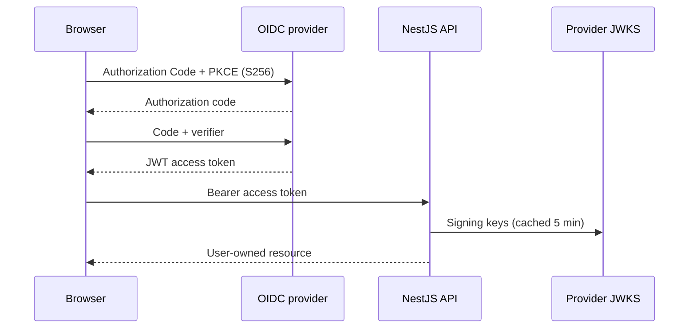

# Phase 13 authentication and usage controls

Phase 13 makes identity the production ownership boundary and adds two independent forms of
abuse control: a short request window in Redis and an atomic UTC-day allowance in PostgreSQL.
Neither a request body nor a browser-generated identifier is trusted as a production user ID.

## Identity architecture



The web client discovers the provider from `/.well-known/openid-configuration`, verifies that
the returned issuer is the configured issuer, requires HTTPS endpoints outside localhost, and
uses Authorization Code with PKCE `S256`, random `state`, and `nonce`. The callback rejects
missing, stale, or mismatched transactions. Access tokens live in `sessionStorage`, expire
locally, and are never copied to application logs, URLs, local storage, or request bodies.

The API remains the authority. It accepts only a bearer token, verifies an RS256 or ES256
signature against the configured JWKS, and checks exact issuer, required audience, expiration,
not-before, issued-at, subject, signing-key ID, key use, and key type. It hashes the tuple
`issuer + subject` into a stable internal ID so raw provider subjects are not database keys.
Only a verified email claim is persisted.

The frontend token parser is not a security boundary; every protected API action depends on the
API's cryptographic checks. The provider must issue a JWT access token for the configured API
audience. An opaque token will be rejected by design.

## Managed-provider setup

Create two logical resources in Clerk, Auth0, or another OpenID Connect service:

1. A public single-page/web client using Authorization Code with PKCE and no browser client
   secret.
2. An API/resource server with the audience configured in `JWT_AUDIENCE`.

Register exact callback URLs for each deployed locale you use. The included example uses:

```text
http://localhost:3000/en/auth/callback
```

Set the provider's allowed web origin to the exact `WEB_URL`. Do not enable the implicit grant.
Configure these matching values:

```dotenv
ALLOW_ANONYMOUS_AUTH=false
JWT_ISSUER=https://identity.example.com/
JWT_AUDIENCE=https://api.learnmap.example
JWT_JWKS_URL=https://identity.example.com/.well-known/jwks.json

NEXT_PUBLIC_OIDC_ISSUER=https://identity.example.com
NEXT_PUBLIC_OIDC_CLIENT_ID=public-browser-client-id
NEXT_PUBLIC_OIDC_AUDIENCE=https://api.learnmap.example
NEXT_PUBLIC_OIDC_REDIRECT_URI=https://app.learnmap.example/en/auth/callback
```

`JWT_ISSUER` must exactly match the access token's `iss` claim. The browser issuer is normalized
only for discovery URL construction. All `NEXT_PUBLIC_*` settings are public configuration and
must never contain a client secret.

Production startup fails if anonymous access is enabled or the API OIDC values are incomplete.
The web build fails if only some browser OIDC values are present.

## Development compatibility mode

With `NODE_ENV=development` and `ALLOW_ANONYMOUS_AUTH=true`, a random browser identifier may be
sent in `X-Client-Id`. This supports local work without an identity tenant; it is not
authentication. Production validation rejects this combination. To exercise real login locally,
set anonymous mode to false and register the localhost callback with the provider.

## Authorization and information isolation

`@CurrentUser()` comes exclusively from the authentication guard. `CreateAnalysisDto` and the
shared request schema contain only `youtubeUrl` and `outputLanguage`; global validation rejects
an extra `userId`. Repository predicates include the authenticated ID for:

- history listing;
- full analysis reads;
- compact status and failure-detail reads;
- failed-analysis retries; and
- deletion.

A missing or foreign ID returns the same `404 Analysis not found` response. This avoids revealing
whether another learner owns the record. Controllers never call Prisma directly.

## Short-term request limiting

All counters are keyed by the authenticated internal user ID, falling back to the requester IP
only before authentication. The storage implementation uses an atomic Redis Lua increment with a
fixed expiration, so horizontally scaled API replicas share the same counters.

| Route                                         | Profile              | Default limit |
| --------------------------------------------- | -------------------- | ------------: |
| `POST /v1/analyses`                           | Strict plus global   |      5/minute |
| `POST /v1/analyses/:id/retry`                 | Strict plus global   |      5/minute |
| `GET /v1/analyses/:id/status`                 | Moderate plus global |     30/minute |
| `GET /v1/analyses` and other protected routes | Normal               |     60/minute |

Tune windows and counts with `RATE_LIMIT_TTL_MS`, `RATE_LIMIT_MAX`,
`RATE_LIMIT_CREATE_TTL_MS`, `RATE_LIMIT_CREATE_MAX`, `RATE_LIMIT_STATUS_TTL_MS`, and
`RATE_LIMIT_STATUS_MAX`. Redis is intentionally fail-closed: if the shared counter store is
unavailable, protected requests fail instead of silently bypassing abuse controls.

## Persistent daily allowance

`DailyUsage` has a composite primary key `(userId, usageDate)` and a nonnegative
`analysesCreated` counter. `usageDate` is a PostgreSQL `DATE` derived from midnight UTC, making
reset behavior independent of API instance timezone.

Creation uses one database transaction:

1. Recheck the user-scoped cache key.
2. Atomically insert today's counter or increment it only while it is below the configured limit.
3. Create the queued analysis.
4. Commit both changes together.

If another request creates the same cache key concurrently, the losing transaction rolls back
its provisional usage increment and returns the existing record. Cache hits do not consume a
new allowance. Exceeding the daily limit returns `429 Too Many Requests`. The default allowance
is `DAILY_ANALYSIS_LIMIT=5`.

Manual retry does not consume another daily unit because it continues the same analysis record.
Queue handoff failures remain visible as a safe failed record and count as an accepted creation;
the user can retry that record without another daily charge.

## Migration and rollout

Apply the additive migration before deploying the Phase 13 API:

```bash
pnpm --filter @learnmap/database db:deploy
```

The migration creates `DailyUsage`, its date index, a cascading user foreign key, and a
nonnegative counter check. It does not rewrite existing analyses. Deploy in this order:

1. Back up PostgreSQL and apply migrations.
2. Configure the OIDC provider and exact callback/origin allowlists.
3. Deploy the API with anonymous mode disabled.
4. Deploy the web application with all browser OIDC values.
5. Smoke-test sign-in, token expiry, all ownership operations, each 429 profile, and the UTC reset.

Monitor authentication failures, Redis availability, daily-quota 429 rates, and JWKS fetch
failures. Never log tokens, authorization headers, authorization codes, code verifiers, or raw
identity-provider error bodies.

## Standards and framework references

- [OpenID Connect Discovery 1.0](https://openid.net/specs/openid-connect-discovery-1_0.html)
- [RFC 7636 — Proof Key for Code Exchange](https://datatracker.ietf.org/doc/html/rfc7636)
- [RFC 9700 — OAuth 2.0 Security Best Current Practice](https://datatracker.ietf.org/doc/html/rfc9700)
- [NestJS rate limiting](https://docs.nestjs.com/security/rate-limiting)
- [Prisma transactions](https://www.prisma.io/docs/orm/prisma-client/queries/transactions)
