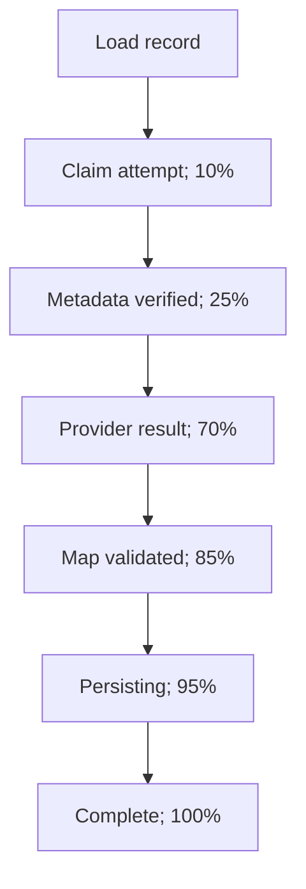

# Phase 9 BullMQ worker

Phase 9 makes long-running video analysis an independently deployable background workload. The
API writes the durable database record, adds a minimal job, and returns `202 Accepted`; it never
waits for YouTube or Gemini processing.

## Components

| Component                     | Responsibility                                                          |
| ----------------------------- | ----------------------------------------------------------------------- |
| `AnalysisQueueService`        | Validates and adds jobs from the API                                    |
| `analysis-job.ts`             | Shared queue name, payload schema, options, and job-ID function         |
| `AnalysisProcessor`           | Owns the BullMQ worker, Redis connection, events, concurrency, shutdown |
| `AnalysisJobHandler`          | Executes the processing and retry state machine                         |
| `AnalysisRepository`          | Encapsulates all worker database writes                                 |
| `YoutubeMetadataService`      | Rechecks availability and duration at processing time                   |
| `VideoAnalysisProvider`       | Runtime provider boundary returning a validated normalized result       |
| `GeminiVideoAnalysisProvider` | Gemini transport, prompt, structured output, and post-processing        |
| `ProcessingError`             | Carries a safe code and permanent/transient classification              |

## Queue contract

The only job data is:

```json
{ "analysisId": "cm..." }
```

The strict Zod schema rejects unknown fields, preventing API keys, user tokens, URLs, or provider
responses from entering Redis. Producer and consumer import the same contract.

Jobs use three total attempts, exponential backoff starting at five seconds, completed retention
of one day or 1,000 jobs, and failed retention of seven days. A stable
`analysis-<analysisId>` job ID deduplicates repeat enqueue attempts for the same database record.

The proposed raw cache key cannot safely be used as the global BullMQ job ID in this application:
the database cache key is intentionally reusable by different users, while BullMQ job IDs are
queue-global. Using it directly could suppress another user’s job. The analysis ID retains
queue-level deduplication without cross-user collision. It also contains no colon, which BullMQ
prohibits in custom job IDs.

## Processing sequence



1. Parse the queue payload and load the analysis.
2. Exit when the record is missing or already completed.
3. Atomically accept only `QUEUED` or `PROCESSING`, set `PROCESSING`, preserve the first
   `startedAt`, increment `attemptCount`, and write 10% progress.
4. Verify that the stored URL is the canonical URL for the stored video ID, then re-fetch YouTube
   metadata from the fixed Google endpoint. This catches videos that became private,
   non-embeddable, unavailable, unsupported, or too long after API submission.
5. Write 25% progress after metadata has been verified, then call Gemini using current title and
   duration metadata.
6. Write 70% progress after the provider returns.
7. The provider parses and normalizes untrusted output. The handler then reapplies the shared
   schema, graph, and duration constraints before persistence.
8. Write 85% after final validation and 95% before persistence.
9. Save summary, map, independently detected video language, provider/model provenance,
   `COMPLETED`, `completedAt`, and 100% in one database update. Emit BullMQ 100% progress. These
   values drive the frontend's processing phases.

The worker is idempotent for missing or completed records. A unique job lock prevents simultaneous
processing of one job, while the database claim protects against stale or manually duplicated
deliveries.

## Retry policy

| Failure                                 | Safe code example                  | Retry? |
| --------------------------------------- | ---------------------------------- | -----: |
| Invalid job/video ID                    | `INVALID_VIDEO_ID`                 |     No |
| Missing/private/non-embeddable video    | `VIDEO_NOT_PUBLIC`                 |     No |
| Unsupported duration                    | `UNSUPPORTED_VIDEO`                |     No |
| Video over configured limit             | `VIDEO_TOO_LONG`                   |     No |
| Provider safety block                   | `SAFETY_POLICY_REJECTION`          |     No |
| YouTube/Gemini timeout or network error | `*_TEMPORARILY_UNAVAILABLE`        |    Yes |
| Provider `429`                          | `PROVIDER_RATE_LIMIT`              |    Yes |
| Provider `5xx`                          | `PROVIDER_TEMPORARILY_UNAVAILABLE` |    Yes |
| Invalid AI JSON/graph result            | Contract error code                |    Yes |
| Unexpected database/Redis failure       | `TEMPORARY_PROCESSING_FAILURE`     |    Yes |

For a transient failure before the final attempt, the database record returns to `QUEUED` while
BullMQ schedules its backoff. A permanent error uses `UnrecoverableError` to stop retries. A
transient error on the final attempt is stored as `FAILED`. The failed-event listener provides a
second best-effort persistence path if infrastructure was unavailable during error handling.

Only safe codes and generic learner-facing messages enter PostgreSQL. Raw Google responses,
exception messages, API keys, database URLs, request bodies, and tokens are not logged or copied
into BullMQ failure messages.

## Operations

Run the worker independently:

```bash
pnpm --filter @learnmap/worker start:prod
```

Set `WORKER_CONCURRENCY` from 1–20. Start conservatively (the default is 2) because each job can
hold a long provider request and consumes upstream quota. Multiple worker processes may share the
same queue. Scale against queue wait time, provider limits, memory, and database capacity.

On shutdown, NestJS closes the BullMQ worker first—allowing active jobs to finish and releasing
locks—then closes its Redis connection. Keep the platform termination grace period longer than the
maximum expected in-flight operation.

Operational alerts should cover queue age/depth, failed count, stalled jobs, repeated `429`s,
worker restarts, and analyses stuck in `PROCESSING`. Redis/Valkey must use persistence and a
`noeviction` memory policy in production.
