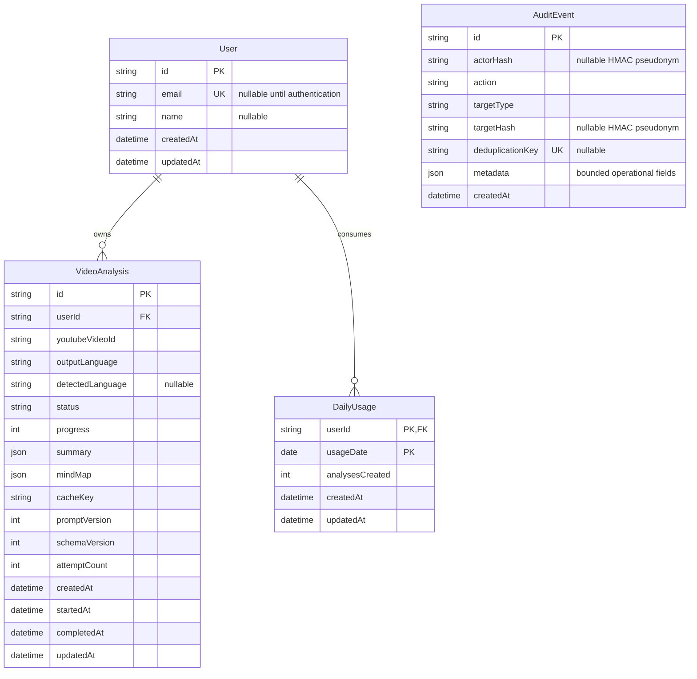

# Database design and migrations

Phase 6 uses PostgreSQL 17 through Prisma ORM. The canonical model is
`packages/database/prisma/schema.prisma`; committed SQL migrations are the only mechanism that
changes a deployed database.

## Data model



### `User`

`User` is the ownership boundary for analyses. Its primary key is a CUID by default. During the
anonymous MVP, the API uses the validated `X-Client-Id` as this ID and leaves `email` null. This
preserves the existing browser history without inventing email addresses. When authentication is
implemented, only verified, normalized email addresses should be stored.

`email` is nullable and unique. PostgreSQL permits multiple null values in a unique index while
preventing two real users from sharing the same stored email.

Deleting a user cascades to their analyses. Application code should treat account deletion as a
high-impact operation and require explicit authorization and confirmation before invoking it.

### `VideoAnalysis`

Each analysis stores authoritative YouTube metadata, its requested output language, independently
detected video language, processing
state, structured result JSON, provider diagnostics, cache versions, retry state, and lifecycle
timestamps. The JSON values are validated by `@learnmap/contracts` before persistence and again
before an API response is rendered.

The database uses these indexes:

| Index                               | Purpose                                                                    |
| ----------------------------------- | -------------------------------------------------------------------------- |
| Unique `(userId, cacheKey)`         | Prevent duplicate work for one user without exposing another user's record |
| `(userId, createdAt)`               | Efficient reverse-chronological history queries                            |
| `(youtubeVideoId, outputLanguage)`  | Video/language analytics and administrative lookup                         |
| `(status)`                          | Worker operations and queue monitoring                                     |
| Unique `User.email`                 | Protect verified identity uniqueness                                       |
| `DailyUsage (userId, usageDate)`    | One persistent UTC-day quota counter per user                              |
| `DailyUsage (usageDate)`            | Retention cleanup and aggregate operational reporting                      |
| `AuditEvent (createdAt)`            | Time-based audit retention                                                 |
| `AuditEvent (actorHash, createdAt)` | Pseudonymous actor investigation                                           |
| `AuditEvent (action, createdAt)`    | Event-type review                                                          |

The cache key intentionally remains unique per user rather than globally unique. Global
uniqueness would make the first user's row own the result and would complicate access isolation.

## Database-level integrity

The Phase 6 SQL migration adds PostgreSQL check constraints that Prisma's schema language does
not currently express:

- `progress` is from 0 through 100;
- `durationSeconds` is null or nonnegative;
- `promptVersion` and `schemaVersion` are positive; and
- `attemptCount` is nonnegative.
- `DailyUsage.analysesCreated` is nonnegative.

Keep these checks in future migrations. Running `prisma format` or `prisma generate` does not
remove them.

## Migration history

| Migration                                            | Purpose                                                             |
| ---------------------------------------------------- | ------------------------------------------------------------------- |
| `20260903000000_init`                                | Create enums and the original analysis table                        |
| `20260903143000_add_users_and_integrity_constraints` | Create users, preserve existing owners, add the relation and checks |
| `20260904170000_add_detected_language`               | Persist the validated source-video language independently           |
| `20260904190000_add_daily_usage`                     | Add the persistent user-owned UTC daily quota ledger                |
| `20260905180000_add_security_audit`                  | Add pseudonymous audit events and rotation deduplication            |

The detected-language migration is additive and nullable. It preserves every existing analysis;
older rows remain unknown rather than guessing from their requested output language.

The daily-usage migration is also additive. Creation uses `INSERT ... ON CONFLICT ... DO UPDATE`
inside the same transaction as the analysis insert. The `WHERE` clause prevents increments at or
above the limit, and transaction rollback prevents duplicate cache-key races from consuming a
unit. Cache reuse and manual retries do not increment the ledger.

`AuditEvent` deliberately has no `User` foreign key. Actor and target identifiers are HMAC-SHA-256
pseudonyms keyed by `AUDIT_HASH_PEPPER`, so account deletion can erase the user row while retaining
a time-limited operational trail that cannot be joined back without the secret pepper. Metadata
is limited to non-sensitive counters and categories. It must never contain prompts, tokens, keys,
URLs, generated text, email addresses, or raw errors.

The Phase 6 migration is safe for an existing Phase 1–5 database:

1. It creates `User`.
2. It inserts one user for every distinct existing `ownerId`.
3. It renames `ownerId` to `userId` without copying or dropping analysis data.
4. It replaces the old owner indexes with user indexes.
5. It adds the required cascading foreign key.
6. It adds numeric integrity constraints.

Migration files are immutable after release. Correct a released migration with a new migration;
never edit SQL that may already exist in another environment.

## Local development

Start PostgreSQL and verify that it is healthy:

```bash
pnpm infra:up
pnpm doctor:services
```

Create a development migration after changing `schema.prisma`:

```bash
pnpm --filter @learnmap/database db:migrate -- --name descriptive_change
```

Then regenerate the client and run the quality gate:

```bash
pnpm db:generate
pnpm db:validate
pnpm validate
```

Use Prisma Studio only on an environment whose data you are authorized to inspect:

```bash
pnpm db:studio
```

## Production deployment

Apply committed migrations once per release before switching application traffic:

```bash
pnpm install --frozen-lockfile
pnpm db:generate
pnpm --filter @learnmap/database db:deploy
```

`db:deploy` runs `prisma migrate deploy`. It applies pending migrations without creating new
ones and is suitable for non-interactive deployment automation.

Never use these in production:

- `prisma migrate dev`, because it is an interactive development workflow;
- `prisma db push`, because it bypasses the audited migration history; or
- automatic schema synchronization at application startup.

Take and verify a restorable database backup before migrations that change or remove data. Run
migrations as a dedicated release job so multiple API or worker replicas cannot race to apply
them. If a migration fails, stop the rollout, inspect Prisma's migration state, and follow the
documented recovery procedure for the database platform—do not mark it successful manually
without verifying the actual schema.

## Connection management

`@learnmap/database` exports one process-local `PrismaClient`. In development, the instance is
cached on `globalThis` to prevent hot reloads from opening additional pools. Production should
place a managed pooler in front of PostgreSQL when replica counts or serverless concurrency can
exceed the database's connection budget.

The package also exports `disconnectDatabase()` for scripts and controlled shutdown paths. Do
not disconnect the shared client after individual HTTP requests or jobs.

## Verification

```bash
pnpm db:validate
pnpm --filter @learnmap/database test
pnpm --filter @learnmap/database db:generate
```

The tests verify the ownership relation, cascade policy, user-scoped cache key, query indexes,
data-preserving migration order, check constraints, and production migration command. Schema
validation does not connect to a database and therefore remains deterministic in CI.
