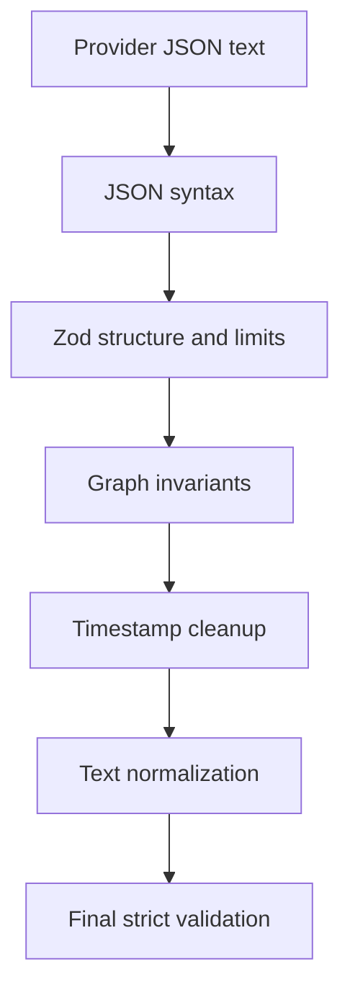

# Shared analysis data contract

`@learnmap/contracts` is the only source of truth for analysis data exchanged by the web
application, API, worker, and AI provider. It provides runtime Zod schemas and the TypeScript
types inferred from those schemas, preventing the runtime and compile-time definitions from
drifting apart.

The primary implementation is
`packages/contracts/src/video-analysis-result.ts`. Applications import only from the package
entry point:

```ts
import {
  parseVideoAnalysisJson,
  validateVideoAnalysisResult,
  videoAnalysisResultSchema,
  type VideoAnalysisResult,
} from '@learnmap/contracts';
```

## Contract limits

| Field               | Rule                                  |
| ------------------- | ------------------------------------- |
| Output language     | `ar` or `en`                          |
| Detected language   | `ar`, `en`, or `other`                |
| Title               | 1–250 trimmed characters              |
| Overview            | 1–3,000 trimmed characters            |
| Learning objectives | At most 8; each 1–300 characters      |
| Main ideas          | At most 12                            |
| Key takeaways       | At most 12; each 1–400 characters     |
| Glossary            | At most 15 entries                    |
| Mind-map nodes      | 1–30                                  |
| Map depth           | At most 4 levels, including the root  |
| Children per node   | At most 6                             |
| Timestamps          | Nonnegative integer seconds or `null` |

All objects are strict. Unknown properties are rejected instead of being silently persisted.
Required text is trimmed and cannot consist only of whitespace.

`detectedLanguage` describes the source video and is produced by the provider. It is not the
requested output language. The API's stored-analysis contract therefore carries both fields, with
`detectedLanguage: null` allowed while processing or for analyses created before Phase 12.

## Validation pipeline



The AI provider calls `processVideoAnalysisJson`. It accepts raw model text only at that boundary,
performs the complete pipeline, and returns a `VideoAnalysisResult`. The worker calls
`validateVideoAnalysisResult` again immediately before persistence. `parseVideoAnalysisJson`
remains available for strict callers that want out-of-range timestamps to fail instead of being
cleaned. The API and web client validate stored data with the same schemas.

### Structural checks

Zod validates JSON-compatible values, required fields, enums, string sizes, integer timestamps,
array sizes, and the 30-node limit. This means a syntactically valid provider response is not
automatically trusted.

### Graph checks

A valid map has:

- exactly one node with `type: "root"`;
- a `null` parent only on that root;
- unique node IDs;
- existing parent references for every non-root node;
- no self-reference or multi-node cycle;
- every node connected to the root;
- no node deeper than four levels; and
- no parent with more than six children.

Graph validation is linear in the number of nodes. Maps are indexed with `Map` instances, so
validation does not repeatedly scan the whole node collection.

### Timestamp checks

When processing model output, negative timestamps and timestamps beyond the authoritative YouTube
duration are changed to `null`. The remaining analysis is preserved because AI timestamps are
approximate navigation aids. The final canonical schema permits only a nonnegative integer or
`null`, and strict validation rejects any out-of-range timestamp that bypasses provider cleanup.

The duration option itself must be a nonnegative integer:

```ts
const result = validateVideoAnalysisResult(providerValue, {
  durationSeconds: 1_800,
});
```

Omit `durationSeconds` only when authoritative metadata is unavailable. Structural timestamp
checks still apply.

## Error handling

The validation API throws `ContractValidationError` with a stable machine-readable code:

| Code                     | Meaning                               | Retry policy                 |
| ------------------------ | ------------------------------------- | ---------------------------- |
| `INVALID_JSON`           | Provider output is not valid JSON     | Provider call may be retried |
| `INVALID_SCHEMA`         | Shape, bounds, or graph checks failed | Provider call may be retried |
| `TIMESTAMP_OUT_OF_RANGE` | A timestamp exceeds video duration    | Provider call may be retried |

The public error message never includes raw provider output. The `issues` array contains safe
field paths and validation messages suitable for server-side diagnostics. It should not be sent
to an end user without the API's normal error sanitization.

## Structured output with Gemini

The worker derives JSON Schema directly from the Zod schema:

```ts
const jsonSchema = z.toJSONSchema(videoAnalysisResultSchema);
```

This avoids maintaining a second provider-specific schema. Gemini structured output constrains
the response shape, but runtime validation remains mandatory. JSON Schema cannot express dynamic
video-duration bounds or all parent-reference, connectivity, depth, and cycle rules. The worker
therefore validates the model response even when Gemini reports structured JSON.

See the official
[Gemini structured-output documentation](https://ai.google.dev/gemini-api/docs/structured-output).

## Example result

```json
{
  "title": "Introduction to neural networks",
  "detectedLanguage": "en",
  "summary": {
    "overview": "The lesson introduces the basic structure of a neural network.",
    "learningObjectives": ["Identify inputs, weights, and outputs."],
    "mainIdeas": [
      {
        "title": "A neuron combines inputs",
        "explanation": "Inputs are weighted before an activation is produced.",
        "timestampSeconds": 42
      }
    ],
    "keyTakeaways": ["Training adjusts weights using observed error."],
    "glossary": [
      {
        "term": "Weight",
        "definition": "A learned value controlling an input's influence."
      }
    ]
  },
  "mindMap": {
    "nodes": [
      {
        "id": "root",
        "parentId": null,
        "title": "Neural networks",
        "explanation": "A map of the lesson's core concepts.",
        "timestampSeconds": 0,
        "type": "root",
        "directlySupported": true
      },
      {
        "id": "topic-1",
        "parentId": "root",
        "title": "Artificial neuron",
        "explanation": "It combines weighted inputs and applies an activation.",
        "timestampSeconds": 42,
        "type": "topic",
        "directlySupported": true
      }
    ]
  }
}
```

## Changing the contract

1. Change the Zod schema and inferred types in `@learnmap/contracts`.
2. Add success and failure tests for every new invariant.
3. Update the worker prompt if generation expectations changed.
4. Update this document and any API examples.
5. Increment `ANALYSIS_SCHEMA_VERSION` when persisted or cached results are no longer compatible.
6. Run `pnpm validate` and `pnpm format:check` from the repository root.

Phase 5 sets `ANALYSIS_SCHEMA_VERSION=2`, ensuring results generated under the earlier contract
are not reused by the analysis cache.

Phase 12 sets both analysis versions to `3`. This prevents a cached pre-Phase-12 record from
silently bypassing detected-language persistence and the stricter language instructions.
