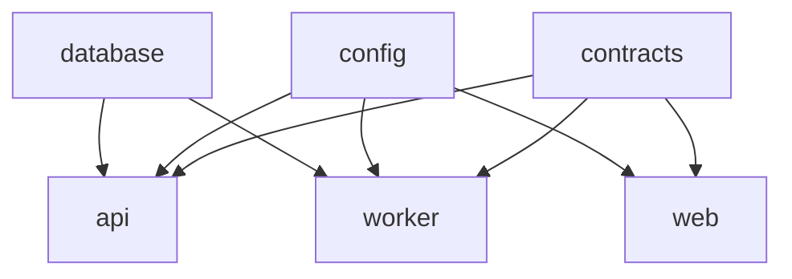

# Monorepo architecture

Phase 3 organizes LearnMap as one pnpm workspace coordinated by Turborepo. Applications stay
independently deployable while contracts, database access, validation, and engineering rules
remain consistent.

## Repository layout

```text
youtube-learning-map/
├── apps/
│   ├── api/                    # NestJS HTTP API
│   ├── web/                    # Next.js student interface
│   └── worker/                 # NestJS BullMQ consumer
├── packages/
│   ├── config/                 # Runtime environment schemas
│   ├── contracts/              # Shared domain schemas and types
│   ├── database/               # Prisma client, schema, and migrations
│   ├── eslint-config/          # Shared lint policies
│   └── typescript-config/      # Shared compiler policies
├── infra/                      # Local container infrastructure
├── scripts/                    # Setup and repository diagnostics
├── pnpm-workspace.yaml
└── turbo.json
```

## Project responsibilities

| Project                       | Responsibility                                        | May depend on               |
| ----------------------------- | ----------------------------------------------------- | --------------------------- |
| `@learnmap/web`               | Forms, history, summaries, player, and mind map       | contracts, config           |
| `@learnmap/api`               | Validation, data access, throttling, and job creation | contracts, config, database |
| `@learnmap/worker`            | Gemini requests and long-running job processing       | contracts, config, database |
| `@learnmap/contracts`         | Zod schemas and inferred TypeScript domain types      | Zod only                    |
| `@learnmap/config`            | Validated environment contracts                       | Zod only                    |
| `@learnmap/database`          | Prisma schema, migrations, and singleton client       | Prisma only                 |
| `@learnmap/eslint-config`     | Shared Node and Next.js lint policy                   | lint tooling only           |
| `@learnmap/typescript-config` | Strict compiler bases for apps and libraries          | no runtime dependencies     |

Applications must never import source files from another application. Shared behavior belongs
in a package with an explicit public export. All internal dependencies use `workspace:*`, so a
package cannot silently resolve to a registry copy.

## Shared TypeScript configuration

- `base.json` owns strict, platform-neutral defaults.
- `nestjs.json` adds decorators and CommonJS output for NestJS applications.
- `nextjs.json` adds bundler resolution, JSX, and Next.js compiler integration.
- `library.json` enables declaration output for reusable packages.

Each project keeps only its local paths such as `rootDir`, `outDir`, aliases, and includes. This
avoids copying safety flags between projects and makes strictness changes atomic.

## Shared ESLint configuration

`@learnmap/eslint-config/node` creates type-aware ESLint configurations for the API and worker.
It requires the consuming project's directory so TypeScript's project service resolves the
correct configuration.

`@learnmap/eslint-config/next` owns common ignores. Next.js 15 still exposes legacy shareable
configs, so the small `FlatCompat` bridge intentionally remains in `apps/web/eslint.config.mjs`.
When upgrading to a Next.js release with native flat config, remove that bridge in the same
change as the framework upgrade.

## Task orchestration

Turborepo derives execution order from package dependencies:



Build, lint, test, and type-check tasks wait for dependency builds. Development tasks are
persistent and uncached. `NEXT_PUBLIC_API_URL` and `NODE_ENV` are declared build inputs so
Turborepo does not reuse a web build produced for a different environment.

## Common commands

```bash
pnpm install --frozen-lockfile
pnpm dev
pnpm workspace:check
pnpm validate
pnpm format:check
```

Target one workspace without changing directories:

```bash
pnpm --filter @learnmap/web dev
pnpm --filter @learnmap/api test
pnpm --filter @learnmap/worker build
pnpm --filter @learnmap/database db:studio
```

## Adding an application or package

1. Create it under `apps/` or `packages/`.
2. Give it a unique `@learnmap/*` package name and mark it private unless publishing is intended.
3. Add shared packages with the `workspace:*` protocol.
4. Extend the correct `@learnmap/typescript-config/*` preset.
5. Import the appropriate lint preset.
6. Implement `build`, `lint`, `test`, and `typecheck` scripts when applicable.
7. Add the project to `scripts/check-workspace.mjs` so structural drift fails early.
8. Run `pnpm install`, `pnpm workspace:check`, and `pnpm validate`.

## Git initialization and first commit

The source archive intentionally excludes `.git` history. After extraction, initialize the
repository and create a verified baseline commit:

```bash
git init
git branch -M main
git add .
git status
git commit -m "chore: initialize LearnMap monorepo"
```

Review `git status` before committing. `.env`, dependencies, build output, coverage, logs, and
local database files are ignored. `.gitattributes` normalizes source files to LF while keeping
PowerShell scripts compatible with Windows.

## Dependency policy

- Add runtime packages to the application or package that imports them.
- Add repository-wide tools to the root only when root scripts invoke them.
- Commit `pnpm-lock.yaml` and use `--frozen-lockfile` in automation.
- Review new dependency lifecycle scripts before allowing them in `pnpm-workspace.yaml`.
- Keep secrets in deployment configuration; never put them in package manifests or Turbo tasks.
- Upgrade related framework packages together and run the full quality gate.
