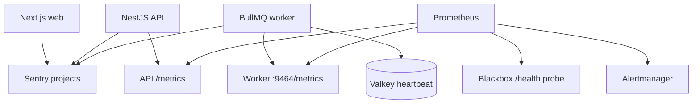

# Phase 16 observability

Phase 16 adds privacy-safe correlated logs, Prometheus metrics, Sentry error reporting, worker
heartbeats, external health probing, and actionable alerts. Observability is an operational aid;
it does not replace audit records, provider billing reports, or database backups.

## Signal flow



Use separate Sentry projects and DSNs for browser, API, and worker so ownership, releases, alert
volume, and sampling can be tuned independently. The same environment variable name can hold a
different value in each deployed service.

## Structured JSON logs

NestJS runs with JSON logging. Application events are created through the shared
`@learnmap/observability` allowlist. Worker start, completion, retry, terminal failure, heartbeat,
and API cache/queue/request events can contain:

```json
{
  "event": "analysis_processing_completed",
  "requestId": "request-12345678",
  "analysisId": "cm12345678901234567890123",
  "userId": "issuer-scoped-pseudonymous-id",
  "videoId": "dQw4w9WgXcQ",
  "provider": "gemini",
  "model": "configured-model",
  "status": "COMPLETED",
  "durationMs": 1234.5,
  "attemptNumber": 1
}
```

Fields are flat, bounded, and allowlisted. Unknown and nested values are discarded. Never add
headers, cookies, request/response bodies, prompt text, model output, environment objects, database
connection strings, or `Error` objects to a log event. In particular, never log API keys, bearer
tokens, raw authorization headers, or full `DATABASE_URL`/`REDIS_URL` values.

`userId` is the application's issuer-scoped pseudonymous ID, not an email or raw OIDC subject.
`requestId` is validated at the HTTP boundary and propagated in the strict BullMQ payload. Use it
to connect API and worker events. Do not use `analysisId`, `userId`, `videoId`, or `requestId` as
Prometheus labels; their high cardinality belongs in logs and traces only.

## Metrics endpoints

| Endpoint                   | Purpose                                                          | Production access                      |
| -------------------------- | ---------------------------------------------------------------- | -------------------------------------- |
| API `GET /metrics`         | HTTP, create/cache, queue-depth, and worker-availability metrics | `Authorization: Bearer $METRICS_TOKEN` |
| Worker `GET :9464/metrics` | Outcomes, duration, provider errors, validation, cost, heartbeat | `Authorization: Bearer $METRICS_TOKEN` |
| API `GET /health`          | PostgreSQL, Valkey/BullMQ, and worker-heartbeat readiness        | Public, minimal response               |
| Worker `GET :9464/health`  | Worker process liveness                                          | Public, minimal response               |

An unauthorized production metrics request returns 404, not an authentication challenge. The
authorization value is never logged. Development permits local scraping without a token;
production deployments must set a random `METRICS_TOKEN` of at least 32 characters and restrict
the endpoints at the network layer as well.

## Required dashboard queries

| Product signal          | PromQL                                                                                                                                                     |
| ----------------------- | ---------------------------------------------------------------------------------------------------------------------------------------------------------- |
| Analyses per day        | `sum(increase(learnmap_analyses_created_total[1d]))`                                                                                                       |
| Completion rate         | `sum(rate(learnmap_analysis_outcomes_total{status="completed"}[30m])) / sum(rate(learnmap_analysis_outcomes_total{status=~"completed\|failed"}[30m]))`     |
| Average processing time | `sum(rate(learnmap_analysis_processing_duration_seconds_sum[30m])) / sum(rate(learnmap_analysis_processing_duration_seconds_count[30m]))`                  |
| Provider errors         | `sum by (error_code) (increase(learnmap_ai_provider_errors_total[1h]))`                                                                                    |
| Validation failures     | `increase(learnmap_ai_validation_failures_total[1h])`                                                                                                      |
| Queue depth             | `learnmap_queue_jobs{state=~"waiting\|active\|delayed\|failed"}`                                                                                           |
| Worker availability     | `learnmap_worker_available` and `learnmap_worker_up`                                                                                                       |
| Average estimated cost  | `sum(increase(learnmap_analysis_estimated_cost_usd_sum[1d])) / sum(increase(learnmap_analysis_estimated_cost_usd_count[1d]))`                              |
| Cache-hit rate          | `sum(rate(learnmap_analysis_cache_hits_total[1h])) / (sum(rate(learnmap_analysis_cache_hits_total[1h])) + sum(rate(learnmap_analyses_created_total[1h])))` |

Histograms permit percentile dashboards with `histogram_quantile`. Keep metric labels bounded to
known status, provider, model, output-language, retryability, and stable error-code values.

### Cost semantics

Set `AI_ESTIMATED_COST_PER_VIDEO_MINUTE_USD` from the current model/region pricing assumption. The
worker records `video duration × configured rate` once per completed analysis. This is suitable for
capacity and trend monitoring, but is not an invoice: provider caching, tiered pricing, audio/video
tokenization, retries, taxes, and discounts can differ. Reconcile it regularly against the provider
billing export and update the setting without exposing billing credentials.

## Sentry configuration

Runtime values:

- API and worker: `SENTRY_DSN`, `SENTRY_ENVIRONMENT`, `SENTRY_RELEASE`,
  `SENTRY_TRACES_SAMPLE_RATE`.
- Browser: `NEXT_PUBLIC_SENTRY_DSN`, `NEXT_PUBLIC_SENTRY_ENVIRONMENT`,
  `NEXT_PUBLIC_SENTRY_RELEASE`, `NEXT_PUBLIC_SENTRY_TRACES_SAMPLE_RATE`.
- Next.js server/edge uses the service-private `SENTRY_DSN`.

The SDK is disabled when its DSN is empty. `sendDefaultPii` is false. API/worker and browser
`beforeSend` hooks remove headers, cookies, bodies, and URL query strings. Server-side errors add
only pseudonymous IDs and stable codes as Sentry tags. Configure Sentry's server-side scrubbing as
a second layer and restrict project access.

For readable production stack traces, provide `SENTRY_AUTH_TOKEN`, `SENTRY_ORG`, and
`SENTRY_PROJECT` only to the web build job. Never expose the auth token as `NEXT_PUBLIC_*`, runtime
environment, container layer, or client bundle. Delete source maps from public build artifacts
after upload and use the same immutable release name for deployment and upload.

## Local monitoring stack

Run the API and worker on the host, then start the optional profile:

```bash
pnpm infra:up
pnpm dev
pnpm infra:observability
```

Prometheus is available at `http://localhost:9090`; Alertmanager is at
`http://localhost:9093`. The checked-in profile uses pinned Prometheus, Alertmanager, and
blackbox-exporter images. Its scrape targets use `host.docker.internal`.

The example Alertmanager receiver points to `http://host.docker.internal:5001/alerts` and is only a
local placeholder. Before production, replace it with an approved PagerDuty, Opsgenie, Slack,
email, or authenticated webhook integration managed through deployment secrets. Test one warning
and one critical notification end to end.

In production, use a managed Prometheus-compatible service or private collectors, TLS, network
policies, and secret-backed scrape credentials. Do not expose ports 9090, 9093, or 9464 publicly.

## Uptime monitoring

Configure an external uptime provider to request `GET /health` every 60 seconds from at least two
regions. Require HTTP 200 and a JSON body with `status: "ok"`. Alert after two consecutive minutes
and resolve only after two successful checks. `/health` intentionally fails when PostgreSQL,
Valkey, the queue, or the worker heartbeat is unavailable, so it is a readiness/SLO probe. Use the
worker's `/health` only for diagnosing the worker process itself.

## Alerts and runbooks

Prometheus rules live in `infra/observability/alerts.yml`. Each uses a `for` duration to reduce
flapping and links to the matching runbook.

### API or worker down

1. Confirm the external probe and service instance health in a second region.
2. Inspect only correlation-safe logs for `analysis_worker_error` or `worker_heartbeat_failed`.
3. Check PostgreSQL and Valkey availability and provider/platform incidents.
4. Restart or scale the failed service through the deployment platform; do not delete queued jobs.
5. Confirm a fresh heartbeat, `/health` 200, and one successful synthetic analysis before closing.

### Queue backlog

1. Compare waiting, active, delayed, and failed depth with worker availability and concurrency.
2. Check provider 429/5xx metrics before adding workers; scaling into provider throttling worsens it.
3. If capacity is the constraint, increase workers gradually within database and provider quotas.
4. If intake is abnormal, preserve existing per-user limits and investigate abusive patterns using
   pseudonymous IDs—never authorization headers.
5. Confirm queue depth is falling for at least 15 minutes.

### Provider or validation failures

1. Group by stable `error_code`, model, release, and prompt/schema version.
2. Compare Sentry regressions and the provider status page without exposing raw model output.
3. Roll back a model/prompt change when the Phase 15 quality gate or validation rate regresses.
4. Do not bypass Zod, hierarchy, timestamp, or safety validation to restore throughput.

## Retention and access

Keep application logs for 30 days by default, detailed Sentry events for 30–90 days, and aggregated
metrics for 13 months when policy allows. Apply regional/student privacy requirements, role-based
access, SSO/MFA, access reviews, encryption, and deletion procedures. Observability vendors are
data processors and must be included in the privacy inventory and agreements before production.
