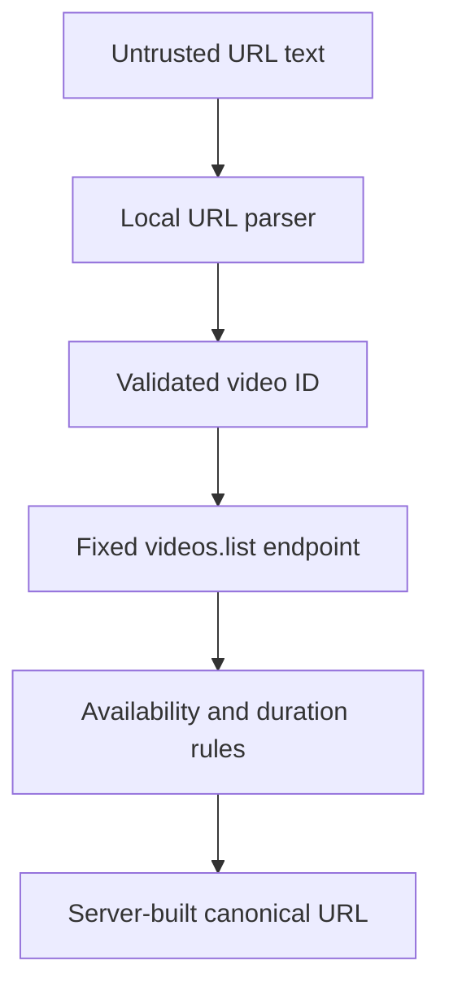

# YouTube URL and metadata integration

Phase 7 treats every submitted URL as untrusted text. The API parses it locally, keeps only a
validated 11-character video ID, builds its own canonical URL, and contacts only Google's fixed
YouTube Data API endpoint.

## Request flow



The submitted origin, path, query parameters, and fragment are never used as a fetch target.
Only the extracted ID crosses into metadata retrieval. Only the canonical URL is persisted and
later sent to the analysis worker.

## Accepted URL forms

The parser accepts HTTPS variants of:

```text
https://www.youtube.com/watch?v=VIDEO_ID
https://youtube.com/watch?v=VIDEO_ID
https://m.youtube.com/watch?v=VIDEO_ID
https://youtu.be/VIDEO_ID
https://www.youtube.com/shorts/VIDEO_ID
https://www.youtube.com/embed/VIDEO_ID
https://www.youtube.com/live/VIDEO_ID
```

Normal sharing or tracking query parameters and fragments are ignored. Leading and trailing
whitespace is removed before parsing.

The parser rejects:

- HTTP, FTP, missing schemes, and nonstandard ports;
- credentials embedded in the URL;
- lookalike, subdomain, suffix, and trailing-dot hostnames;
- playlist, channel, search, and other non-video routes;
- path smuggling through unexpected extra segments; and
- video IDs that are not exactly 11 characters from `A-Z`, `a-z`, `0-9`, `_`, and `-`.

`canonicalYouTubeUrl` independently validates its input before returning:

```text
https://www.youtube.com/watch?v=VIDEO_ID
```

## Why this prevents SSRF through the submitted URL

The API never calls `fetch(input)` or derives a network hostname from the submitted URL. Metadata
requests always use the constant origin and path:

```text
https://www.googleapis.com/youtube/v3/videos
```

The only user-derived query value is the format-restricted video ID. Redirect following is
disabled. This design prevents a submitted URL from directing the API toward loopback, private
networks, cloud metadata services, alternate ports, or attacker-controlled hosts.

This boundary applies to all future code: do not replace the canonical URL with the original
input, even after metadata validation.

## Metadata request

The API calls `videos.list` using:

| Parameter | Value                           |
| --------- | ------------------------------- |
| `part`    | `snippet,contentDetails,status` |
| `id`      | Validated 11-character video ID |
| `key`     | Server-side `YOUTUBE_API_KEY`   |

The request costs one YouTube Data API quota unit according to Google's
[videos.list documentation](https://developers.google.com/youtube/v3/docs/videos/list). It uses a
10-second timeout, requests JSON, and rejects redirects.

The API response is untrusted until its Zod schema passes. The service requires:

- a returned item whose ID matches the requested ID;
- a non-empty title and channel title;
- at least one HTTPS thumbnail;
- a parseable, positive ISO 8601 duration;
- `privacyStatus` equal to `public`;
- `embeddable` equal to `true`; and
- duration less than or equal to `MAX_VIDEO_DURATION_SECONDS`.

Thumbnail selection prefers `maxres`, then `standard`, `high`, `medium`, and `default`.
`contentDetails.duration`, `status.privacyStatus`, and `status.embeddable` are fields documented on
the official [YouTube video resource](https://developers.google.com/youtube/v3/docs/videos).

## Error behavior

| Condition                                                                             | API behavior              |
| ------------------------------------------------------------------------------------- | ------------------------- |
| Invalid or unsupported URL                                                            | `400 Bad Request`         |
| Missing video                                                                         | `404 Not Found`           |
| Private, unlisted, non-embeddable, too long, invalid duration, or no usable thumbnail | `400 Bad Request`         |
| Timeout, network failure, non-success response, or malformed upstream JSON            | `503 Service Unavailable` |

Raw Google error messages, response bodies, and API keys are never returned to clients. Do not log
the complete request URL because the YouTube key is a query parameter.

## Captions API policy

The application does not call `captions.download` for arbitrary public videos. Google documents
that downloading a caption track requires authorization and permission to edit the video; it is
not a general transcript endpoint. See the official
[captions.download documentation](https://developers.google.com/youtube/v3/docs/captions/download).

LearnMap analyzes the public canonical YouTube URL through its configured AI provider instead of
attempting unauthorized caption access or scraping YouTube pages.

## Tests

Run:

```bash
pnpm --filter @learnmap/api test
```

The suite covers every accepted route, hostname and path confusion attacks, protocol and port
rejection, ID and canonical URL validation, duration conversion, fixed endpoint construction,
timeout configuration, metadata availability rules, exact duration boundaries, malformed JSON,
network failures, mismatched IDs, and safe upstream errors. Tests mock `fetch` and never consume
Google quota.
